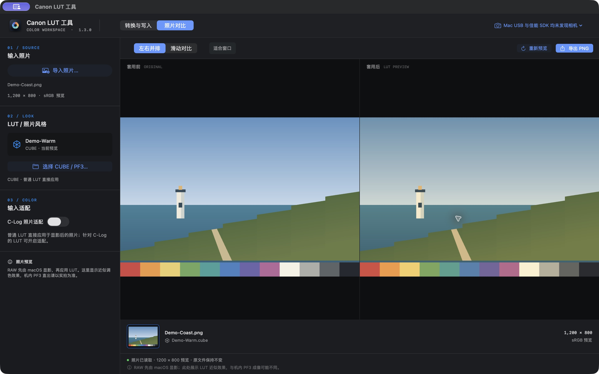

# Canon LUT 工具 · R6 III

面向 macOS Apple Silicon 的 CUBE → PF3 工具与照片对比工作台，包含 Canon EOS R6 Mark III 的实验性 USB 照片风格注册流程。

[下载测试版](https://github.com/Jie-su/canon-lut-tool-r63/releases) · [首次使用](docs/SETUP.md) · [开发说明](docs/DEVELOPMENT.md) · [R7 → R6 III 技术记录](docs/R7_TO_R6III.md)



界面图使用项目自带生成器制作的原创示例，不含私人照片或第三方 LUT。示例生成：`python3 examples/generate_demo.py`。

## 能做什么

- 导入单个 CUBE 或文件夹，批量生成 PF3、full33 载荷和校验清单。
- 在深色工作台中并排或滑动比较照片，导出预览 PNG。
- 直接预览 CUBE 与 PF3；工具生成的 PF3 可读取文件内色表，不必找回原 CUBE。
- 可选 C-Log 2／3 照片近似适配，并指定 LUT 色域与输出编码。
- 自动识别佳能 USB 设备，提供连接诊断；写入时暂停后台探测。
- 为指定的 R6 III 用户槽 1–3 备份、写入并重新请求设备数据验证。

这是 **v1.3.0-beta.1 公开测试版**。此前的私有实现曾在一台 R6 III／固件 1.1.2 上通过恒等 LUT、红蓝交换、机内 JPEG 和一次关机重启验证，并完成过三槽写入。公开版增加了使用者自己的本地配置初始化，不能把这些历史结果视为所有用户、固件或 LUT 的兼容保证。

## 下载与开始使用

1. 从 [Releases](https://github.com/Jie-su/canon-lut-tool-r63/releases) 下载 macOS arm64 ZIP 和校验文件，解压 App。
2. 打开“照片对比”，导入照片与自己的 CUBE，即可开始预览；这一步不需要连接相机。
3. 如需转换或写入，先按[初始化指南](docs/SETUP.md)准备自己的 Standard PF3 基底与只读相机快照，建立本机配置。

发行包包含应用与独立 Python 运行环境，不需要另装 Python 或 pip。发行包采用 ad-hoc 签名，**尚未经过 Apple Developer ID 签名和公证**，macOS 可能阻止直接打开。请核对来源与校验文件，并参考 [Apple 关于安全打开 App 的说明](https://support.apple.com/en-us/102445)自行处理系统提示；也可以从源码构建。

## 支持范围

| 项目 | 当前范围 |
| --- | --- |
| 桌面 App | Apple Silicon／arm64，macOS 13 或更新版本 |
| 相机写入 | 仅本代码已设守卫的 EOS R6 Mark III／1.1.2／固定 SDK 与描述符版本 |
| 普通照片 | JPEG、PNG、HEIC、TIFF；RAW／CR3 取决于 macOS 解码器支持 |
| CUBE | 纯 3D `.cube`；不宣称任意混合 1D／3D 格式均可解析 |
| 原生 PSE PF3 预览 | Canon RAW／CR3，经本机 Canon 离线显影组件处理 |
| 本工具生成的 PF3 预览 | 读取内嵌色表，对 JPEG／受支持 RAW 做照片近似预览 |
| Windows／Intel Mac | 未提供桌面发行包 |

转换、原生 PF3 预览和相机功能需要使用者合法安装相应的 Canon EOS Utility 3／Picture Style Editor。软件版本与二进制 hash 检查不通过时会停止；不能通过取消检查来假定兼容。

### PF3、LUT 与照片预览

PF3 文件与实际相机安装载荷是两个对象。对于本工具从 CUBE 生成的文件，请保留同目录的：

```text
名称.pf3
名称.full33.bin
名称.manifest.json
```

普通 EOS Utility 重新导入此类 dense PF3 时可能根据 PSE 参数重建色表，不能保证保留 CUBE 效果，应使用本工具及配套载荷。官方 PSE 通过曲线、色轴等参数制作的原生 PF3 则属于另一条正常注册路线。

CUBE 及内嵌色表预览展示照片上的近似方向；原生 PSE PF3 使用 Canon 离线 RAW 显影。两者均不等于机内实拍。PF3 预览沿用文件保存的设置，不额外叠加 C-Log 适配。JPEG 已经显影，原生 PSE 照片风格不能在此接口中直接套到 JPEG；请导入对应 RAW。源照片和 RAW 不会被改写。

针对 Log 的 LUT 应按原说明选择输入曲线、色域和输出。照片近似适配不是相机传感器的真实 C-Log 视频管线，也不保证任意 C-Log 2／3 LUT 可以互换。

## 从源码构建

安装 Apple Command Line Tools／Swift／Clang，以及 Python.org 的 Python 3.13，然后在仓库根目录运行：

```sh
python3 app/build_app.py --output "dist/Canon LUT 工具.app"
```

构建器从公开源码编译相机和离线预览辅助程序，生成图标、打包重定位的 arm64 Python 运行环境并做本地签名验证。它不会下载或打包 Canon 专有库，不会放入个人的 PF3 基底、相机快照或 LUT。

纯 Python 测试无需 Canon 软件或相机，Linux／macOS 都可以运行：

```sh
PYTHONPATH=src python3 -m unittest discover -s src/r6lut -t src -p 'test_*.py'
python3 scripts/audit_public_tree.py
```

更多入口与代码结构见[开发说明](docs/DEVELOPMENT.md)。

## 开放源码与来源

本项目以 [MIT](LICENSE) 发布，保留 [EdwinjJ1/canon-lut-lab](https://github.com/EdwinjJ1/canon-lut-lab) 的版权与许可，R6 III 适配、桌面界面和公开发行整理在其研究基础上继续开发。

[Lut-to-Canon-Picture-Style](https://github.com/LvClFER/Lut-to-Canon-Picture-Style) 为 full33 格式和研究验证提供了参考。该项目的代码和资产没有整体收入本仓库，不能将其视为由本仓库 MIT 许可证授权。依赖、运行时修改和第三方许可见 [THIRD_PARTY_NOTICES.md](THIRD_PARTY_NOTICES.md)。

仓库与发行包不包含 Canon SDK／MLib／DppCore 二进制、用户机身数据、第三方 LUT、私人原片或实验备份。Canon 等名称属于各自权利人；本项目与 Canon 无隶属关系。

## English

An open-source macOS Apple Silicon tool for CUBE-to-PF3/full33 conversion, before/after photo comparison, and experimental Canon EOS R6 Mark III Picture Style installation. CUBE preview works without a camera. Conversion uses your own locally initialized PF3/camera context; Canon software and personal device data are not redistributed. Native PSE PF3 preview requires supported Canon RAW, while embedded-grid PF3 preview is a photographic approximation. Camera support is limited to the pinned R6 III 1.1.2 environment. The downloadable beta is ad-hoc signed and is not Apple-notarized.
